# Google AI Ultra 1ヶ月無料ガイド

ProxyPin を使って `one.google.com` のレスポンスを書き換え、Google AI Ultra プランの「1ヶ月間無料トライアル」を出す手順のスクリーンショット付きガイドです。

## 必要なもの

- iPhone または iPad(Android は対応していません)
- 脱獄は不要
- このリポジトリの [Google-ai-ultra.config](./Google-ai-ultra.config)(ProxyPin 用のリライト設定)

## セットアップ手順

### 1. ProxyPin をダウンロード

App Store から [ProxyPin - Open Source Capture](https://apps.apple.com/jp/app/proxypin-open-source-capture/id6450932949) をインストールします。

### 2. HTTPS Proxy を有効化

ProxyPin を開き、**Settings → HTTPS Proxy** を選択します。

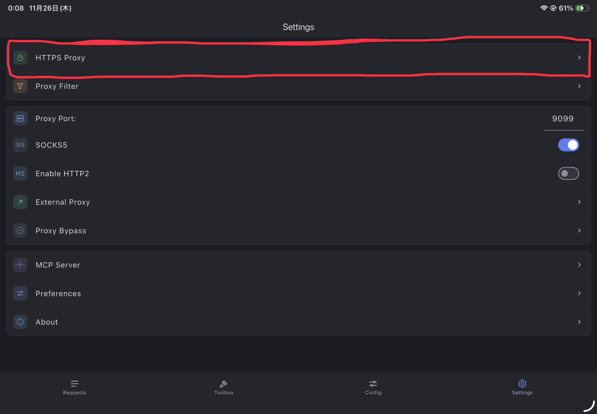

### 3. Root CA をインストール

1. 「Certificate Not Installed」→ **Install Root CA** をタップします。

   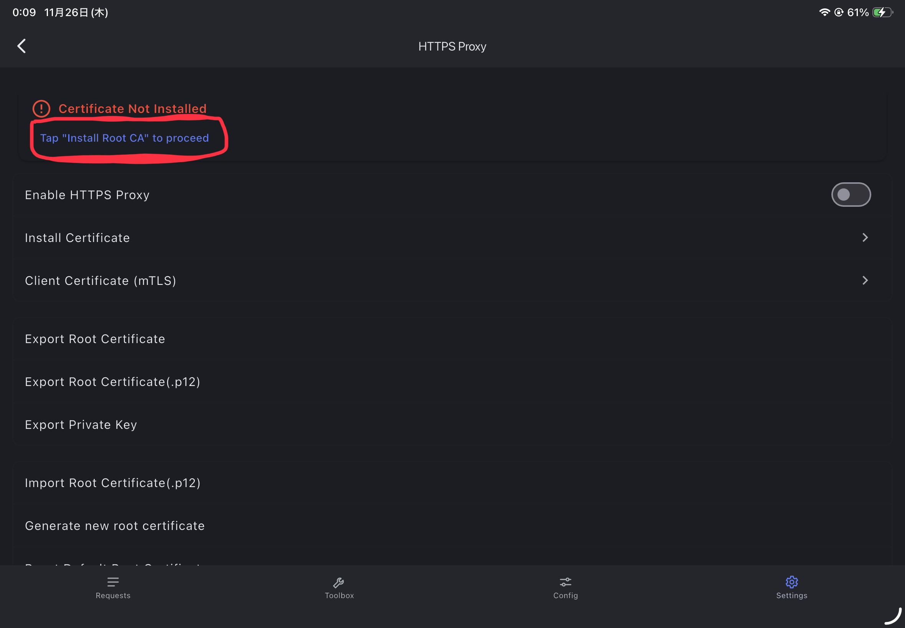

2. Safari で `127.0.0.1:9099` が開き、構成プロファイルのダウンロードを求められるので **許可** を選択します。

   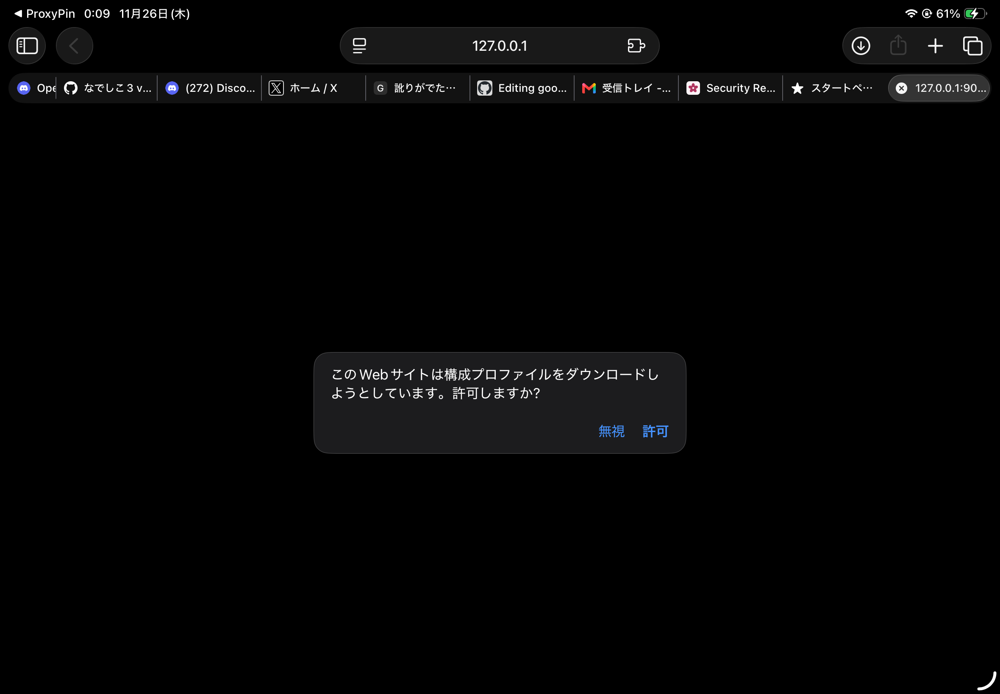

3. iOS の **設定 → ダウンロード済みプロファイル** を開き、ProxyPin CA のプロファイルを **インストール** します。

   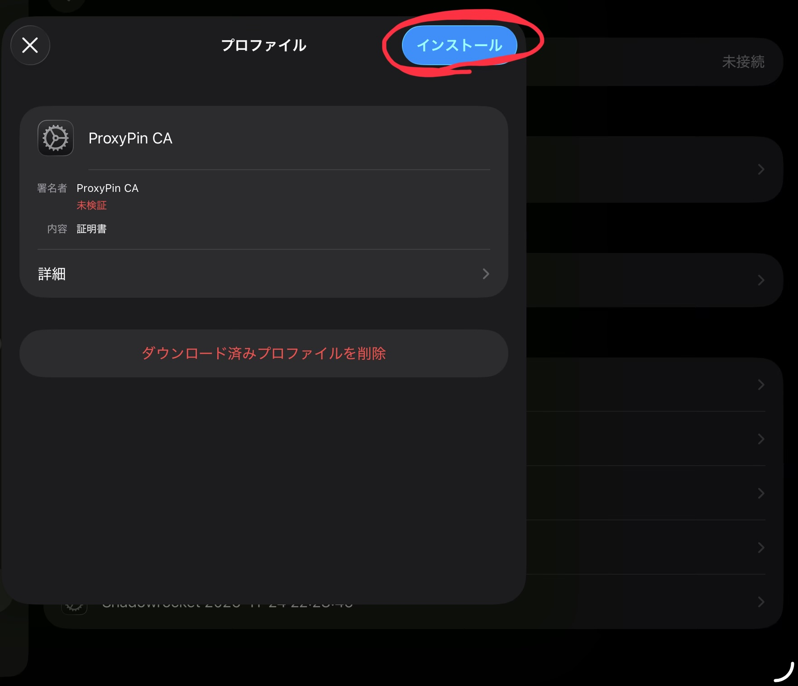

### 4. 証明書を信頼する

1. iOS の **設定 → 一般 → 情報** を開きます。

   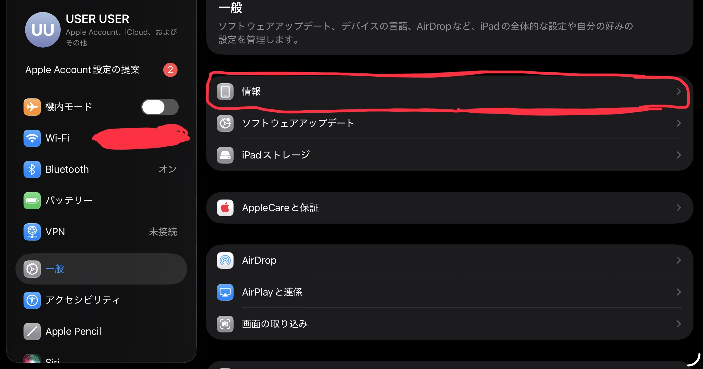

2. 情報画面の一番下にある **証明書信頼設定** を選択します。

   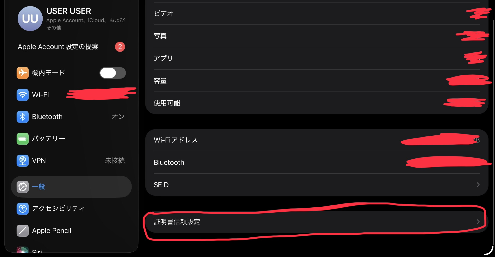

3. 「ルート証明書を全面的に信頼」で **ProxyPin CA** をオンにします。

   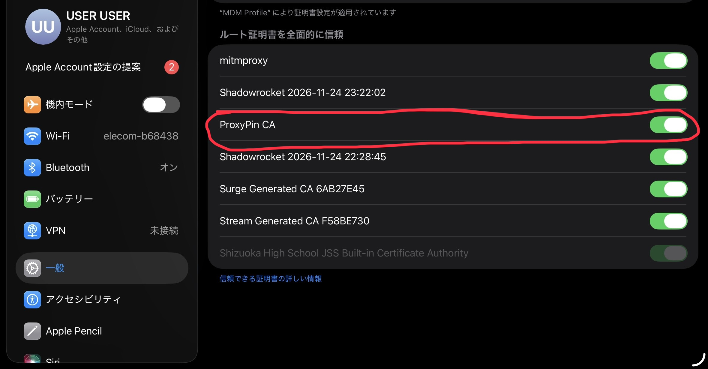

### 5. ホワイトリストに one.google.com を追加

1. ProxyPin の **Settings → Proxy Filter** を開きます。

   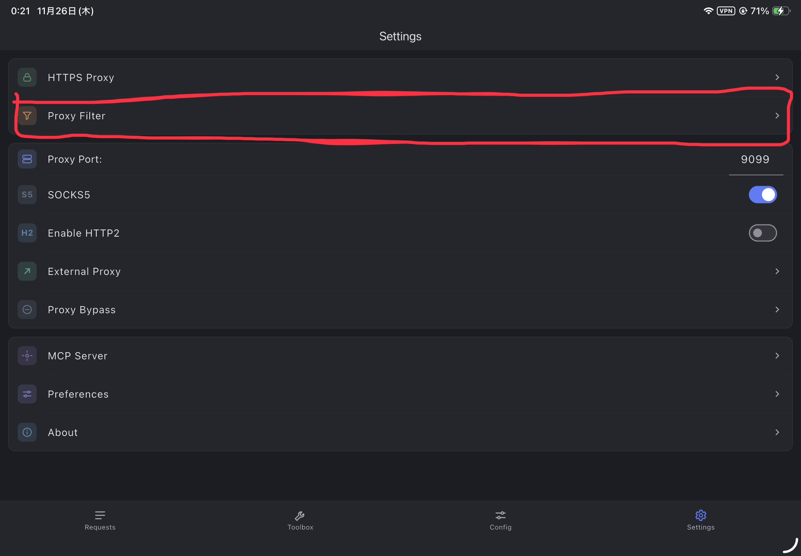

2. **Proxy Domain Whitelist** を選択します。

   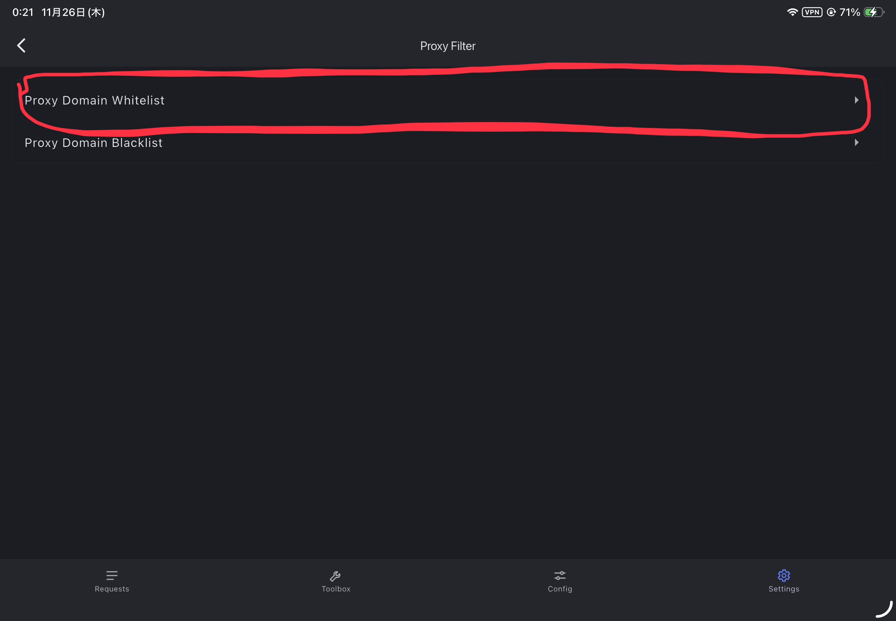

3. **Enable** をオンにし、**Add** を押して Host 欄に `one.google.com` を入力して **Save** します。

   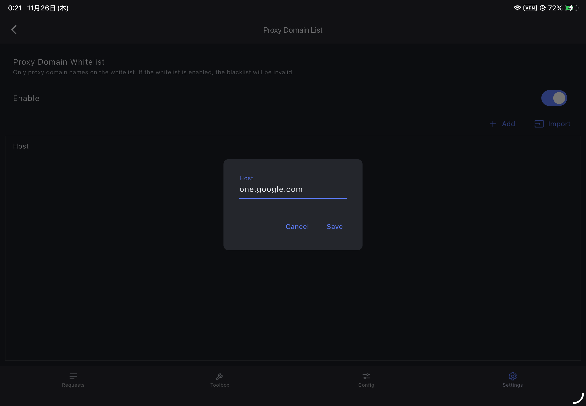

4. 追加されたホワイトリストが有効になっていれば OK です。

   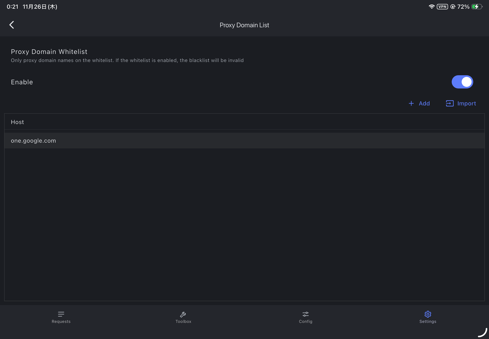

### 6. Request Rewrite に config をインポート

1. ProxyPin の **Config** タブ → **Request Rewrite** を開きます。

   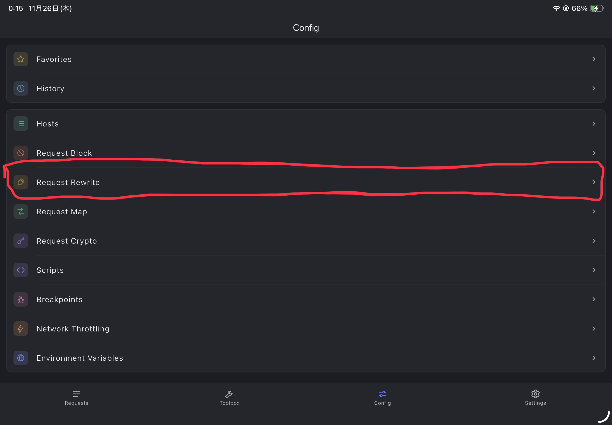

2. **Enable Request Rewrite** をオンにし、**Import** からこのリポジトリの `Google-ai-ultra.config` を読み込みます。
   `g1-acq`(URL: `https://one.google.com/ai?*`、Action: response update)が登録されていれば完了です。

   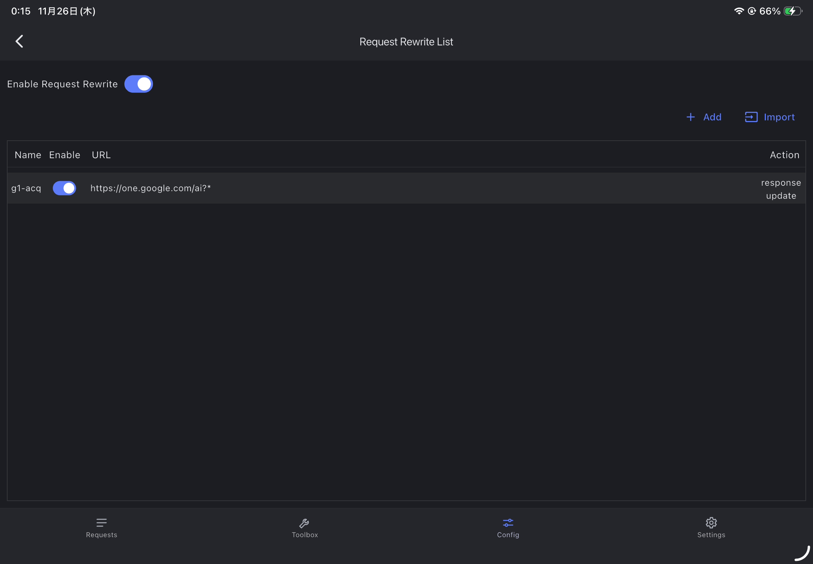

### 7. VPN を起動

**Requests** タブを開き、左下の **▶︎** マークを選択します。「VPN の構成を許可する」画面が出たら許可し、画面上部に **VPN** と表示されれば成功です。

## 動作確認

1. **Google One** または **Gemini** アプリを開き、「アップグレード」から **Ultra** プラン(5x)を選択します。
2. 購入画面で **「1ヶ月間無料トライアル」** が表示されていれば成功です。

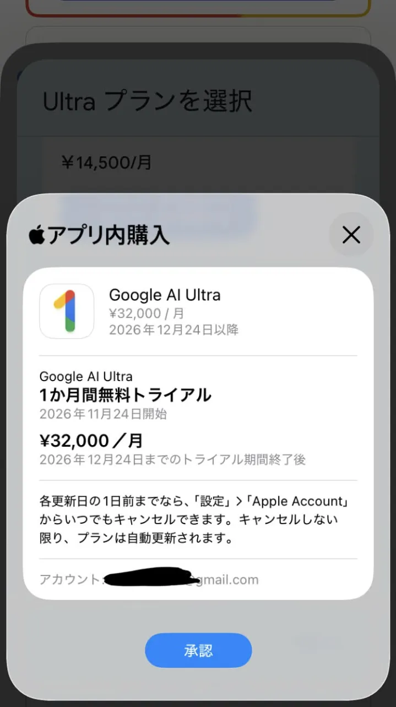

プラン確認画面で現在のプランが **Google AI Ultra** になっています。

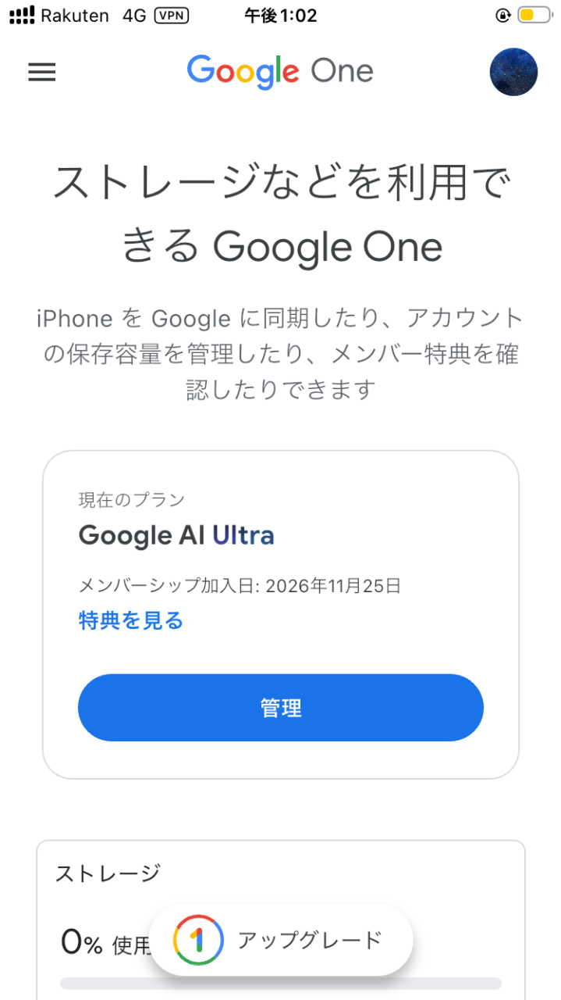

## 注意

- この設定は `one.google.com/ai` のレスポンスを書き換えるものです。実際の請求・契約内容はご自身で必ず確認してください。
- 使用後は ProxyPin の VPN をオフにし、Request Rewrite / Whitelist を無効化しておくと安全です。

## 参考

- https://github.com/crhywun/g1-acq
- https://github.com/Dgkncn/g1-acq-plus
- デモ動画: [video/1K86KBRRF_3QEG2T.mov](./video/1K86KBRRF_3QEG2T.mov)
